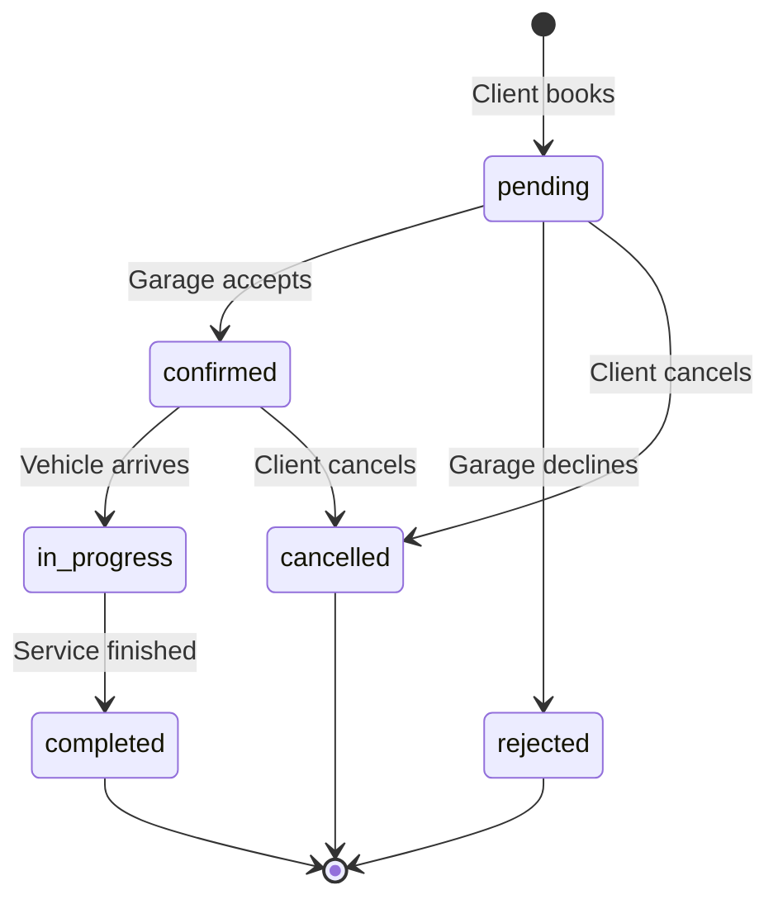

# CARfix — Shared Team Firebase & Database Specification
> **Note for the CARfix Development Team:**
> This document is the single source of truth for all database collections, field names, and enums used across all interfaces (Client, Admin, Spare Parts Dealer, Oil Change Garage, Scanner Garage). 
> **Whenever any field or collection is added or modified, this file is updated.**

---

## 1. Firebase Project Details
- **Project ID:** `carfix-33875`
- **Storage Bucket:** `carfix-33875.firebasestorage.app`
- **Region:** `europe-west1` (or default selected)

---

## 2. Cloudinary Setup (Shared for all Image Uploads)
- **Cloud Name:** `qlguj1ds`
- **Upload Preset (Unsigned):** `carfix_uploads`
- **Upload Endpoint:** `https://api.cloudinary.com/v1_1/qlguj1ds/image/upload`
- *(Use this for spare parts photos, garage photos, diagnostic report images/PDFs, and user profile pictures)*

---

## 3. Standard User Roles (`role` field in `users`)
Use these exact string constants across all authentication checks:

| Role Key | Assigned Sub-Team / Interface | Description |
| :--- | :--- | :--- |
| `"admin"` | Sub-team 2 (Admin Interface) | Full system administration & moderation |
| `"client"` | Sub-team 1 (Client Interface) | Car Owner (books services, searches parts) |
| `"spare_parts_dealer"` | Sub-team 2 (Spare Parts Interface) | Lists parts inventory & manages stock |
| `"oil_change_garage"` | Sub-team 3 (Oil Change Garage) | Offers oil change services & tracks stock |
| `"scanner_garage"` | Sub-team 3 (Scanner Garage) | Performs OBD diagnostics & uploads reports |

---

## 4. Firestore Collections & Document Schemas

### A. Collection: `users`
Stores all registered accounts across all 5 roles.
```json
{
  "uid": "FIREBASE_AUTH_UID",
  "email": "user@example.com",
  "full_name": "Karim Benzema",
  "phone_number": "+213550123456",
  "role": "admin", // "client" | "spare_parts_dealer" | "oil_change_garage" | "scanner_garage" | "admin"
  "avatar_url": "https://res.cloudinary.com/qlguj1ds/image/upload/...",
  "is_active": true,
  "created_at": "TIMESTAMP",
  "updated_at": "TIMESTAMP"
}
```

---

### B. Collection: `spare_parts`
Master parts SKU catalog managed by **Admins** and **Spare Parts Dealers**, searched by **Car Owners (Clients)**.
```json
{
  "id": "AUTO_GENERATED_DOC_ID",
  "category_id": "brakes", // references categories document id
  "category": "Brakes & Braking Systems",
  "part_name": "Brembo Ceramic Front Brake Pads",
  "part_number": "BRM-CC-911", // Manufacturer SKU
  "oem_cross_ref": "992-351-405", // OEM Cross Reference
  "fitment": "Porsche 911 Carrera (992), BMW M3/M4 (G80/G82)", // Applicable vehicle fitment
  "position": "Front Axle Set", // e.g. "Front Axle Set", "DOT Compliant 4-Pack", "380mm Monobloc"
  "spec_tag": "Standard Spec", // "Standard Spec" | "High Temp Teflon" | "Specialty Order" | "High Thermal" | "OEM Replacement"
  "partner_shops_count": 14,
  "car_make": "Volkswagen",
  "car_model": "Golf 7",
  "car_year": 2018,
  "price": 6500, // Price in DZD
  "stock_quantity": 14,
  "is_in_stock": true,
  "image_url": "https://res.cloudinary.com/qlguj1ds/image/upload/...",
  "created_at": "TIMESTAMP",
  "updated_at": "TIMESTAMP"
}
```

---

### B2. Collection: `categories` (Parts Systems & Categories)
Master categories and vehicle systems managed by **Admins**.
```json
{
  "id": "brakes",
  "name": "Brakes & Braking Systems",
  "description": "Braking assemblies, discs, calipers, lines and pads",
  "icon_name": "disc_full", // Material icon identifier
  "parts_count": 8,
  "image_url": "https://res.cloudinary.com/qlguj1ds/image/upload/...",
  "created_at": "TIMESTAMP"
}
```

---

### C. Collection: `garages`
Managed by **Oil Change Garages** & **Scanner Garages**, browsed by **Clients** and **Admins**.
```json
{
  "id": "AUTO_GENERATED_DOC_ID",
  "owner_id": "GARAGE_OWNER_UID",
  "garage_name": "Precision Auto Tech",
  "garage_type": "oil_change", // "oil_change" | "scanner" | "both"
  "address": "12 Boulevard des Martyrs",
  "city": "Algiers",
  "phone": "+213555987654",
  "location": {
    "latitude": 36.7538,
    "longitude": 3.0588
  },
  "oil_types_in_stock": [
    "5W-30",
    "5W-40",
    "10W-40"
  ],
  "scanner_supported_brands": [
    "Renault",
    "Peugeot",
    "Volkswagen",
    "Toyota",
    "Hyundai"
  ],
  "opening_hours": "08:00 - 18:00",
  "rating": 4.8,
  "total_reviews": 42,
  "image_url": "https://res.cloudinary.com/qlguj1ds/image/upload/...",
  "created_at": "TIMESTAMP"
}
```

---

### D. Collection: `appointments`
Created by **Clients (Car Owners)**, confirmed/managed by **Garages**, monitored by **Admins**.
```json
{
  "id": "AUTO_GENERATED_DOC_ID",
  "client_id": "CLIENT_USER_UID",
  "client_name": "Amine Zerrouki",
  "client_phone": "+213551234567",
  "garage_id": "GARAGE_DOC_ID",
  "garage_name": "Precision Auto Tech",
  "service_type": "oil_change", // "oil_change" | "scanner_diagnosis" | "general_checkup"
  "scheduled_at": "2026-11-25T10:00:00Z",
  "vehicle": {
    "make": "Renault",
    "model": "Clio 4",
    "year": 2019,
    "license_plate": "12345-119-16"
  },
  "status": "pending", // "pending" | "confirmed" | "in_progress" | "completed" | "cancelled" | "rejected"
  "notes": "Client requested 5W-40 Total Quartz oil",
  "created_at": "TIMESTAMP",
  "updated_at": "TIMESTAMP"
}
```

---

### E. Collection: `diagnostic_reports`
Created by **Scanner Garages** after OBD testing, viewed by **Clients** and **Admins**.
```json
{
  "id": "AUTO_GENERATED_DOC_ID",
  "appointment_id": "APPOINTMENT_DOC_ID",
  "scanner_garage_id": "GARAGE_DOC_ID",
  "client_id": "CLIENT_USER_UID",
  "vehicle_vin": "VF15R040...",
  "obd_error_codes": [
    "P0300",
    "P0171"
  ],
  "diagnosis_summary": "Random/Multiple Cylinder Misfire Detected. Spark plugs and ignition coils need replacement.",
  "technician_notes": "Cleaned throttle body. Recommend replacing cylinder 2 coil.",
  "report_file_url": "https://res.cloudinary.com/qlguj1ds/image/upload/...",
  "created_at": "TIMESTAMP"
}
```

---

### F. Collection: `oil_brands`
Master catalog of motor oil brands managed by **Admins**.
```json
{
  "id": "mobil_1",
  "name": "Mobil 1",
  "manufacturer": "ExxonMobil",
  "tier": "OEM Certified", // "OEM Certified" | "OEM Partner" | "Aftermarket High-Spec"
  "oil_count": 6,
  "logo_url": "https://res.cloudinary.com/qlguj1ds/image/upload/...",
  "created_at": "TIMESTAMP"
}
```

---

### G. Collection: `oil_formulas`
Specific oil formulations and viscosity grades linked to a brand.
```json
{
  "id": "AUTO_GENERATED_DOC_ID",
  "brand_id": "mobil_1",
  "brand_name": "Mobil 1",
  "viscosity": "0W-40", // e.g. "0W-40", "5W-30", "10W-40", "0W-20"
  "title": "Mobil 1 FS European Formula",
  "composition": "Full Synthetic", // "Full Synthetic" | "Synthetic Blend" | "Conventional Mineral" | "Racing Ester"
  "oem_specs": "MB 229.5, Porsche A40, VW 502 00",
  "category_tag": "Euro Spec", // "Euro Spec" | "Clean Diesel" | "Standard" | "Ultra-Low Vis" | "Motorsport"
  "active_garages_count": 32,
  "created_at": "TIMESTAMP"
}
```

---

## 5. Appointment Status Flow



---

## 6. Centralized Project Files in Codebase
The codebase contains mirrors of these definitions ready to import in Dart:
1. `lib/core/constants/firebase_constants.dart` — Strongly typed Dart strings and constants.
2. `lib/core/constants/firebase_values.json` — Machine-readable JSON dictionary.
3. `FIREBASE_SCHEMA_REFERENCE.md` — This file, ready to share with all sub-teams.
